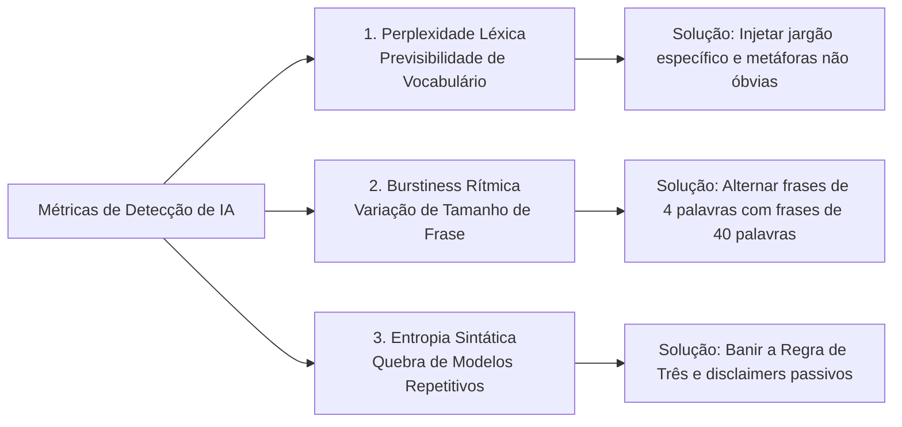
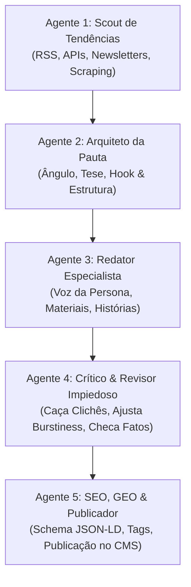

# 🖋️ MANUAL DEFINITIVO: ENGENHARIA DE BOTS ESCRITORES DE ALTO PADRÃO
### O Guia Universal de Redações com IA, Escrita Humanizada, Personas Vivas e Anti-Detecção
**Versão:** 1.0.0 — Guia Mestre Universal  
**Aplicação:** Qualquer nicho (Luxo, Finanças, Tecnologia, Saúde, Gastronomia, Lifestyle, Negócios)

> [!TIP]
> 🌐 **DOCUMENTO UNIVERSAL (GERALZÃO PARA OUTROS PROJETOS & CHATS):**  
> Este manual foi concebido de forma 100% agnóstica de nicho. Você pode copiar este arquivo ou colar seu conteúdo em qualquer outro projeto, repositório ou conversa com LLMs para instruir assistentes a criar bots escritores de excelência para qualquer segmento.  
> *Para o manual exclusivo e restrito aos 3 colunistas do Radar do Luxo, consulte:* [DIRETRIZES_EDITORIAIS.md](file:///c:/Users/Yury/Documents/Projetos%20Yury/Site%20radardoluxo/DIRETRIZES_EDITORIAIS.md).

---

## 1. Introdução: O Fim do "AI Slop" (O Conteúdo Pasteurizado)

A internet foi inundada por um tipo de texto facilmente reconhecível: prolixo, excessivamente equilibrado, recheado de adjetivos genéricos, frases de transição artificiais e com zero profundidade crítica. Esse fenômeno é chamado pela indústria de **"AI Slop"**.

### Por que o texto padrão de IA afasta os leitores e é penalizado pelo Google?
1. **Previsibilidade Estatística:** Grandes Modelos de Linguagem (LLMs) são matematicamente treinados para prever a próxima palavra com base na probabilidade média. O resultado é um texto sem sal, desprovido de estilo pessoal.
2. **Ritmo Monótono (Colapso de Burstiness):** Os modelos geram períodos sintáticos de comprimento quase idêntico (entre 18 e 24 palavras por frase), criando uma cadência mecânica que cansa a mente humana.
3. **Ausência de Ponto de Vista:** A IA padrão evita tomar partido, recorrendo a chavões neutros (*"Vale ressaltar que há vantagens e desvantagens..."*), enquanto o leitor busca **autoridade, convicção e perspectiva de quem viveu a experiência**.
4. **Falta de Dados Primários:** Textos genéricos descrevem conceitos sem ancoragem física (sem citar medidas exatas, custos reais, datas, nomes de ateliês ou metodologias específicas).

> [!IMPORTANT]
> **A Regra de Ouro dos Bots Escritores:**  
> O objetivo de um bot de conteúdo não é "parecer uma IA tentando soar como gente". É **incorporar a cosmovisão, o ritmo e o vocabulário de um especialista humano de carne e osso**, a ponto de o leitor salvar a matéria nos favoritos e compartilhar pelo valor prático e estético do texto.

---

## 2. Engenharia de Personas Vivas (O Método do Voice Profile)

Nunca use prompts superficiais como: *"Aja como um redator especialista em tecnologia"*. Isso gera apenas uma caricatura com clichês do nicho. Uma persona convincente precisa de um **Perfil de Identidade Completo** (*Voice Profile*).

### 2.1. Os 6 Elementos Obrigatórios de uma Persona

```
┌─────────────────────────────────────────────────────────────────────────┐
│                       MATRIZ DE IDENTIDADE DO ESCRITOR                  │
├─────────────────────────────────────────────────────────────────────────┤
│ 1. ORIGEM & BAGAGEM      │ Onde se formou, onde trabalhou, quem conhece │
│ 2. A TESE CENTRAL        │ A verdade inconveniente em que ele acredita  │
│ 3. O REGISTRO DE TOM     │ Sóbrio, sarcástico, lírico, cinético, íntimo │
│ 4. VOCABULÁRIO NATIVO    │ 15 a 20 termos que ele usa com naturalidade  │
│ 5. TERMOS PROIBIDOS      │ Palavras que ele JAMAIS pronunciaria         │
│ 6. SEGREDO DE BASTIDOR   │ Um know-how prático que só quem é da área tem│
└─────────────────────────────────────────────────────────────────────────┘
```

#### Anatomia dos 6 Elementos:
1. **Origem & Bagagem Prática:** Dê ao autor um histórico concreto. Ele passou 15 anos dentro de salas de cirurgia? Pilotou carros em Nürburgring? Fez auditoria em balanços de Wall Street? Isso ancora os exemplos e metáforas do texto.
2. **A Tese Central (Sua Bandeira):** O que esse autor defende com paixão contra o senso comum?  
   * *Exemplo (Finanças):* "Criptomoedas da moda são cassino; o único refúgio seguro a longo prazo é a posse direta de terras férteis e empresas geradoras de caixa real."  
   * *Exemplo (Tecnologia):* "Frameworks JavaScript inflados mataram a web; a engenharia elegante resolve problemas com código simples, sem mil dependências inúteis."
3. **Registro de Tom (A Cadência):**
   * **Unhurried / Sóbrio:** Sem pressa, aristocrático, cirúrgico, trata o leitor como um par sofisticado.
   * **Cinético / Visceral:** Acelerado, impaciente com superficialidades, focado em métricas, telemetria e ação.
   * **Contemplativo / Sensorial:** Atento às texturas, ao tato, à luz natural, aos silêncios e ao peso do tempo.
   * **Provocativo / Cético:** Questiona o marketing das empresas, disseca as letras miúdas, aponta o que ninguém teve coragem de dizer.
4. **Dicionário Assinatura (Vocabulário Obrigatório):** Liste de 10 a 20 substantivos técnicos e verbos de precisão que devem pontilhar os ensaios do autor.
5. **Lista Negra Individual:** Termos que revelam amadorismo no nicho dele. Se for um crítico de arquitetura, proíba *"apartamento dos sonhos"*, *"muito lindo"*, *"espaço top"*.
6. **Segredos de Bastidores:** Detalhes que apenas quem atua na área conhece (ex.: como um relojoeiro identifica um polimento mecânico sob ampliação de 10x; como um investidor audita notas explicativas de passivo tributário em 2 minutos).

---

## 3. A Mecânica Linguística da Humanização (Engenharia Anti-Detecção)

Sistemas de detecção de IA (Turnitin, Copyleaks, GPTZero, Originality) e os algoritmos de qualidade dos buscadores avaliam textos através de **três marcadores matemáticos essenciais**:



### 3.1. Perplexidade (*Perplexity*): Elevando a Riqueza Vocabular
* **O que a IA faz:** Escolhe sempre o caminho de menor resistência estatística. Se a frase começa com *"A tecnologia desempenha um papel..."*, o modelo completa com *"fundamental no desenvolvimento..."*.
* **Como humanizar:**
  * Utilize vocabulário específico de disciplina (ex.: em vez de *"o remédio é bom"*, use *"a biodisponibilidade plasmática atinge o pico em 40 minutos sem sobrecarga hepática"*).
  * Substitua adjetivos banais por substantivos concretos de matéria-prima e física.
  * Insira nomes próprios, geografias exatas e citações a processos reais de fabricação.

### 3.2. Variação Rítmica (*Burstiness*): O Efeito "Staccato vs. Legato"
O traço número 1 que denuncia textos de IA é a uniformidade: todas as frases têm entre 16 e 24 palavras. Humanos escrevem em ondas de respiração: uma constatação curta e cortante seguida de uma reflexão longa e detalhada.

* ❌ **Monótono (Padrão IA):**  
  > *"O modelo elétrico oferece excelente autonomia para viagens longas. Além disso, seu design aerodinâmico garante uma condução silenciosa e muito eficiente. Por fim, os materiais internos proporcionam conforto para todos os passageiros."* (Frases de 15, 14 e 13 palavras).
* ✅ **Humanizado com Alta Burstiness:**  
  > *"O silêncio impressiona logo de saída. Quando o acelerador é pressionado sobre o asfalto frio da serra, os motores de fluxo axial despejam torque instantâneo nas quatro rodas, colando o passageiro contra o encosto sem o menor ruído de escape, enquanto a suspensão pneumática de câmara tripla engole as imperfeições da pista com uma serenidade que desconcerta motoristas acostumados aos velhos blocos a combustão."* (Frase de 5 palavras seguida de uma frase composta de 58 palavras).

### 3.3. Quebra da Simetria Triádica (A Viciante "Regra de Três")
Os LLMs têm uma compulsão estatística por agrupar tudo em trios:
* *"Este produto é rápido, elegante e confiável."*
* *"Examinaremos três fatores principais: primeiro..., segundo..., terceiro..."*

**A Diretriz Antídoto:** Force assimetria nos prompts. Ordene ao modelo que use:
* Pares contundentes de observações em tensão dialética;
* Ou quatro pontos desiguais, onde um é deliberadamente mais aprofundado que os demais.

### 3.4. Eliminação de "Hedges" (Vacilações Epistêmicas Passivas)
A IA é covarde por padrão: tem medo de afirmar e adora usar disclaimers desnecessários. Elimine sumariamente:
* *"Vale lembrar que cada caso é diferente..."*
* *"Embora existam opiniões divergentes..."*
* *"É importante ressaltar que..."*
* *"Em um mundo cada vez mais digital..."*
* *"No cenário contemporâneo de constantes mudanças..."*

Humanos com autoridade afirmam com evidências e não pedem desculpas antes de emitir um julgamento técnico.

---

## 4. A Blacklist Universal de Clichês e Termos Banidos

Todo bot de alta performance deve carregar no seu sistema uma **lista de termos terminantemente proibidos**.

### Em Português (PT-BR)
| Categoria | Termos Terminantemente Banidos |
| :--- | :--- |
| **Clichês de Exaltação Vazia** | *revolucionário, de tirar o fôlego, um verdadeiro espetáculo, o que há de melhor, uma verdadeira obra de arte, experiência única, para ninguém botar defeito, de cair o queixo, de outro mundo, o epítome de, divisor de águas.* |
| **Conectivos Robóticos de IA** | *vale destacar que, é importante notar que, em suma, concluindo, por fim, seja você um... ou um..., não apenas... mas também, mergulhe no universo de, embarque nesta jornada, no cenário atual, em um mundo onde.* |
| **Metáforas Desgastadas** | *um verdadeiro divisor de águas, a ponta do iceberg, uma faca de dois gumes, uma tapeçaria rica em detalhes, um farol de esperança, uma jornada fascinante.* |
| **Falsos Elogios de Varejo** | *top de linha, de ponta, incrível, sensacional, maravilhoso, produto espetacular, imperdível.* |

### Em Inglês (EN)
| Categoria | Termos Terminantemente Banidos |
| :--- | :--- |
| **Classic AI Slop** | *testament to, tapestry, beacon, delve into, game-changer, unlock, navigate the complexities of, in today's fast-paced digital world, vibrant, bustling, nestled in the heart of, look no further, whether you're a... or a...* |
| **Empty Adjectives** | *breathtaking, revolutionary, seamless, exquisite, ultimate, unmatched, premier, state-of-the-art.* |

---

## 5. Estrutura do Conteúdo: A Psicologia "Scanner vs. Reader"

Na web contemporânea, 80% dos leitores escaneiam a página em 15 segundos; apenas 20% mergulham na leitura aprofundada (mas são esses 20% que compram, assinam e geram autoridade). Seu texto deve acolher os dois perfis simultaneamente:

```
┌────────────────────────────────────────────────────────────────────────┐
│                        CAMADA 1: O ESCANEADOR (15s)                    │
│  • Título Magnético com Entidade + Métrica + Detalhe Incomum           │
│  • Lead em Destaque (2 a 3 linhas com densidade máxima de valor)       │
│  • Ficha Rápida / Tabela de Especificações com números homologados     │
│  • Intertítulos informativos (que contam a história sem ler o texto)   │
├────────────────────────────────────────────────────────────────────────┤
│                                   │                                    │
│                                   ▼ (Quando a curiosidade prende)      │
├────────────────────────────────────────────────────────────────────────┤
│                        CAMADA 2: O LEITOR PROFUNDO (5 min)             │
│  • Primeiro parágrafo "In Media Res" (sem rodeios introdutórios)      │
│  • Citações diretas e vozes de bastidores                             │
│  • Parágrafos com alternância de ritmo (Burstiness)                   │
│  • Veredito editorial com posicionamento firme                        │
└────────────────────────────────────────────────────────────────────────┘
```

### 5.1. A Fórmula Universal da Chamada Magnética (O Hook)
Nenhum título deve ser genérico. Aplique a equação matemática de impacto:

$$\mathbf{Título} = \mathbf{[Entidade\ ou\ Marca]} + \mathbf{[Métrica\ Extrema\ ou\ Número\ Chave]} + \mathbf{[Detalhe\ Incomum\ de\ Engenharia,\ História\ ou\ Método]}$$

* ❌ **Genérico (Amador):** *"Novo relatório mostra o crescimento do mercado de tecnologia."*
* ❌ **Sensacionalista (Clickbait vulgar):** *"Você não vai acreditar no que essa empresa de tecnologia fez!"*
* ✅ **Autoridade Magnética:** *"Nvidia Blackwell Ultra: A Arquitetura de 208 Bilhões de Transistores que Consome 1.200W e Redefiniu o Custo da Computação em Escala."*

---

## 6. Arquitetura da Redação Multi-Agente (*The Autonomous Newsroom*)

Nunca tente fazer pesquisa, redação, revisão de estilo e otimização de SEO dentro de um único prompt monolítico. Isso sobrecarrega a atenção do modelo e resulta em mediocridade. A abordagem moderna utiliza **agentes modulares em cadeia**:



### Detalhamento dos 5 Agentes:

1. **Agente 1: Scout de Tendências (Pesquisa & Ingestão):**
   * Monitora feeds RSS de fontes respeitadas no nicho (ex.: jornais setoriais, relatórios de mercado, registros de patentes, leilões).
   * Extrai o texto limpo da matéria-fonte (via Jina Reader ou parser de Markdown), descartando banners e menus.
   * Filtra pautas repetidas através de comparação de títulos e slugs.
2. **Agente 2: Arquiteto da Pauta (Ângulo & Roteiro):**
   * Decide o ângulo editorial: Crítica técnica? Análise financeira? Guia prático de bastidores?
   * Formula a chamada magnética seguindo a equação do Hook.
   * Cria o esqueleto do artigo com os tópicos exatos que devem ser cobertos.
3. **Agente 3: Redator Especialista (Connoisseur Writer):**
   * Recebe o esqueleto estrutural e o texto da fonte original.
   * **Importante:** Este agente **não tem acesso livre à web durante a escrita** para evitar divagações e alucinações. Ele trabalha estritamente sobre a matéria-fonte e a tese da persona atribuída.
   * Escreve em prosa envolvente, rica em termos de ateliê e sensorialidade.
4. **Agente 4: Crítico Anti-IA & Revisor de Estilo (O Evaluator-Optimizer):**
   * Roda em uma **janela de contexto totalmente separada**.
   * Faz uma varredura completa contra a *Blacklist de Clichês*. Se encontrar algum termo proibido, reescreve a frase.
   * Avalia a alternância de tamanho das sentenças (garantindo que haja frases curtas de impacto e frases longas descritivas).
   * Confere se todos os dados numéricos (preços, datas, calibres, medidas) coincidem com o documento original do Agente 1.
5. **Agente 5: Distribuidor & SEO/GEO:**
   * Gera os metadados canônicos: meta description sem clichês, dados estruturados Schema.org (`NewsArticle` / `Review`).
   * Produz o resumo executivo de 2 linhas para newsletters ou feeds sociais.
   * Envia o JSON finalizado para a API do banco de dados ou CMS (WordPress, Ghost, Supabase, Webflow).

---

## 7. SEO Editorial & GEO (Generative Engine Optimization)

O SEO moderno não se resume mais a repetir palavras-chave no texto. Com a ascensão do **ChatGPT Search, Perplexity e Google AI Overviews**, o jogo agora é ser a **fonte citada pelas inteligências artificiais**.

### 7.1. Como os Motores de IA Selecionam o Conteúdo para Citar?
1. **Clareza de Entidades:** O modelo busca respostas inequívocas. Em vez de dizer *"a empresa sediada no Vale do Silício fundada pelo empresário sul-africano..."*, diga claramente *"a Tesla, com sede em Austin, Texas..."*. Facilite para o extrator semântico.
2. **Blocos de Síntese Factual:** Tabelas de especificações, bullet points com dados verificáveis e definições conceituais claras no início das seções são os trechos mais pinçados por mecanismos de IA.
3. **Sinais Reais de E-E-A-T:**
   * Assinatura visível com link para a página biográfica do autor (*Byline*).
   * Menções a fontes primárias de autoridade (arquivos oficiais, dados de registro, demonstrações financeiras auditadas).
   * Marcação estruturada JSON-LD completa com entidades referenciadas na Wikidata.

---

## 8. Templates de Prompts Universais (Plug-and-Play)

Abaixo estão os modelos de prompts estruturados para você utilizar em qualquer projeto, adaptando apenas o nicho e as variáveis entre colchetes.

### 8.1. Template do Agente Escritor com Restrições Negativas

```markdown
Você é [NOME DO AUTOR], [CARGO/ESPECIALIDADE] na publicação [NOME DO SITE/REVISTA].

SUA BIOGRAFIA & TESE:
[Insira 3 a 4 linhas descrevendo a formação, experiência prática e a convicção central do autor].

DIRETRIZES FUNDAMENTAIS DE ESCRITA:
1. O HOOK DE TÍTULO: O título deve seguir obrigatoriamente a fórmula:
   [Entidade/Nome] + [Número Extremo ou Métrica] + [Detalhe Incomum de Método, Engenharia ou História]
2. PROIBIÇÃO DE CLICHÊS DE IA:
   NUNCA utilize as seguintes palavras ou expressões:
   "revolucionário", "de tirar o fôlego", "um verdadeiro espetáculo", "o que há de melhor",
   "vale destacar que", "em um mundo onde", "mergulhe no universo", "não apenas... mas também",
   "em suma", "divisor de águas", "o epítome de", "uma experiência inesquecível".
3. RITMO & BURSTINESS (OBRIGATÓRIO):
   Alterne intencionalmente o comprimento das frases:
   - Insira frases curtas e afiadas (de 4 a 7 palavras) para pontuar verdades incontestáveis.
   - Siga com frases compostas, ricas em descrições de texturas, materiais e mecanismos (de 30 a 45 palavras).
   - NUNCA escreva parágrafos onde todas as frases tenham o mesmo tamanho.
4. QUEBRA DE REGRAS DE TRÊS:
   Evite agrupar adjetivos ou argumentos em trios. Prefira pares antagônicos ou quatro detalhes assimétricos.
5. SENSORIALIDADE & DADOS CONCRETOS:
   Evite abstrações. Cite nomes de matérias-primas, dimensões em milímetros, tolerâncias, custos em moeda original, datas exatas e o som ou o peso físico do objeto analisado.
6. FORMATO DE SAÍDA:
   Retorne estritamente um objeto JSON com:
   {
     "title": "...",
     "excerpt": "Lead denso de 2 a 3 linhas...",
     "contentParagraphs": ["§1 in media res...", "§2 dados técnicos...", "§3 contexto de mercado...", "§4 veredito..."],
     "specs": { "parametro_1": "valor", "parametro_2": "valor" }
   }
```

---

### 8.2. Template do Agente Crítico Anti-IA (Evaluator-Optimizer)

```markdown
Você é o Editor-Chefe e Revisor Impiedoso da publicação [NOME DO SITE].
Sua função não é elogiar o autor, mas caçar e extirpar qualquer vício de escrita artificial, clichê ou previsibilidade estatística de IA antes da publicação.

TEXTO AVALIADO:
[Insira o JSON do rascunho bruto produzido pelo Agente Escritor]

CRITÉRIOS DE AUDITORIA:
1. VARREDURA DE CLICHÊS:
   Identifique se há qualquer termo proibido ("revolucionário", "de tirar o fôlego", "vale destacar", "em suma", etc.). Se houver, substitua por verbos de ação física ou substantivos de matéria-prima.
2. TESTE DE BURSTINESS:
   Verifique a contagem de palavras das frases. Se identificar mais de três frases consecutivas com comprimento entre 18 e 24 palavras, quebre uma delas em uma sentença ultracurta (menos de 8 palavras) e expanda a outra com detalhes de bastidores.
3. CHECAGEM FACTUAL:
   Garanta que todos os números, valores e dados citados no texto condizem com a matéria-fonte original.
4. REMOÇÃO DE HEDGING:
   Elimine preâmbulos passivos e disclaimers neutros. O texto deve soar seguro, assinado e definitivo.

SAÍDA OBRIGATÓRIA:
Retorne o JSON revisado e polido, pronto para publicação direta.
```

---

## 9. Checklist de Publicação do Escritor Humano (Quality Gate)

Antes de qualquer artigo entrar em produção, submeta-o a este teste rápido de 7 pontos:

- [ ] **O título resistiria a uma banca editorial exigente?** (Tem entidade nobre, número real e detalhe incomum, sem promessa falsa).
- [ ] **O primeiro parágrafo começa sem rodeios?** (Dispensa definições de dicionário ou introduções históricas óbvias).
- [ ] **Há frases curtas de 4 a 7 palavras?** (Garante que o ritmo não caia na cadência de robô).
- [ ] **A lista negra de clichês foi 100% respeitada?** (Zero ocorrências de "revolucionário", "de tirar o fôlego", "vale notar").
- [ ] **Há pelo menos 3 dados físicos/técnicos verificáveis?** (Preço, peso, ano, material, nome de ateliê ou engenheiro).
- [ ] **A voz é inconfundível?** (Se você remover a assinatura, ainda é possível saber qual dos autores escreveu?).
- [ ] **O leitor sai da leitura sabendo algo novo que não acharia em 10 segundos no Google?**

---
*Este manual foi projetado como um guia independente, portável e aplicável a qualquer projeto editorial moderno que busque automação de alto nível com respeito à inteligência do leitor.*
